# Project 03 - Network Security Assessment

A small network security assessment completed in a controlled VirtualBox lab using Kali Linux and Ubuntu Server.

## Objective

The goal was to identify network exposure on the Ubuntu server, determine which services were reachable, review the services from the target itself, make controlled changes, and verify the result with a second scan.

## Lab

- Assessment machine: Kali Linux
- Target: Ubuntu Server
- Network: 192.168.1.0/24
- Target IP: 192.168.1.10
- Kali IP: 192.168.1.8
- Tools: Nmap, curl, ss, lsof, UFW

The assessment was performed only against the user's local lab system. No password cracking or exploitation was performed.

## Assessment process

1. Identify the network configuration.
2. Test connectivity between Kali and the target.
3. Discover active hosts.
4. Scan the target for open TCP ports.
5. Identify services and versions.
6. Perform basic OS fingerprinting.
7. Check the HTTP service.
8. Check SSH exposure.
9. Compare external results with services listening on the target.
10. Review the firewall configuration.
11. Stop and disable services that were not needed in the lab.
12. Scan again and verify the result.

## Main findings

The initial assessment found two externally reachable TCP services:

- TCP 22 - OpenSSH
- TCP 80 - nginx

UFW was active with a deny-by-default incoming policy, but ports 22 and 80 were explicitly allowed.

The nginx and SSH services were later stopped and disabled for the lab. The follow-up scans showed both ports as closed.

## Before and after

| Area | Before | After |
|---|---|---|
| SSH | TCP 22 open | TCP 22 closed |
| HTTP | TCP 80 open | TCP 80 closed |
| nginx | Running | Stopped and disabled |
| SSH service | Running | Stopped/disabled in lab |
| UFW | Active | Active |
| Full TCP scan | 22 and 80 open | No open TCP ports found |

## Evidence

### Network configuration

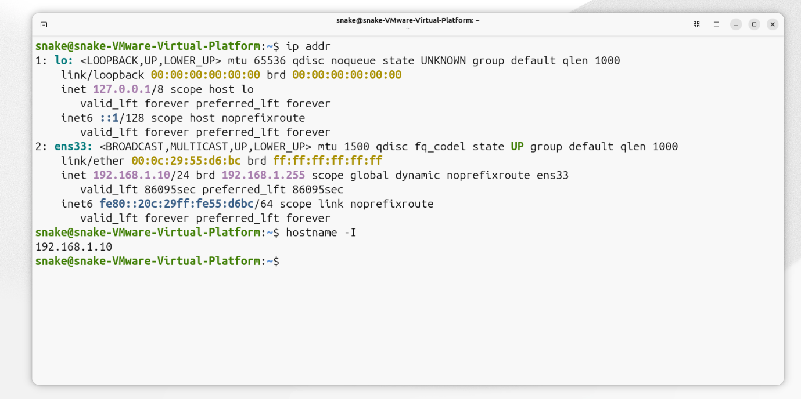

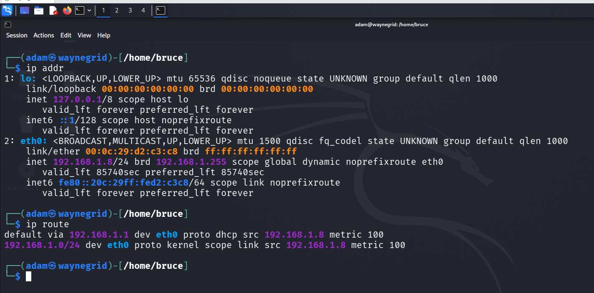

### Connectivity and discovery

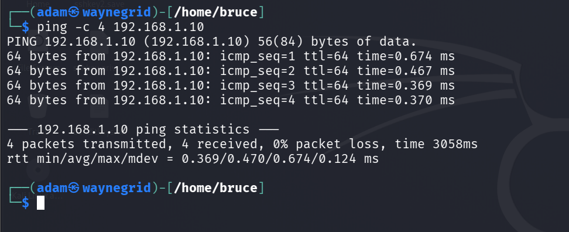

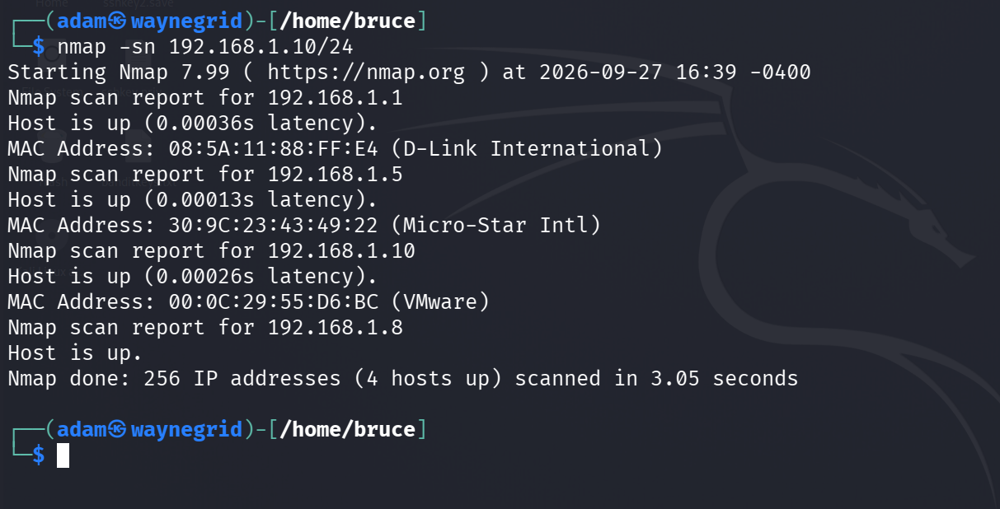

### Enumeration

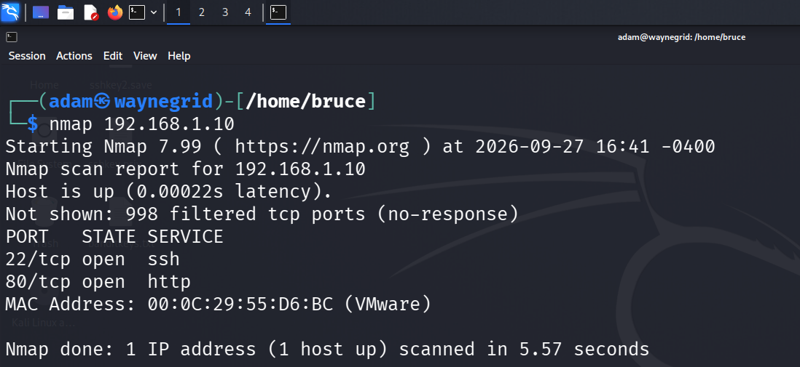

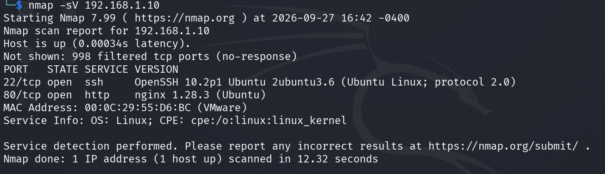

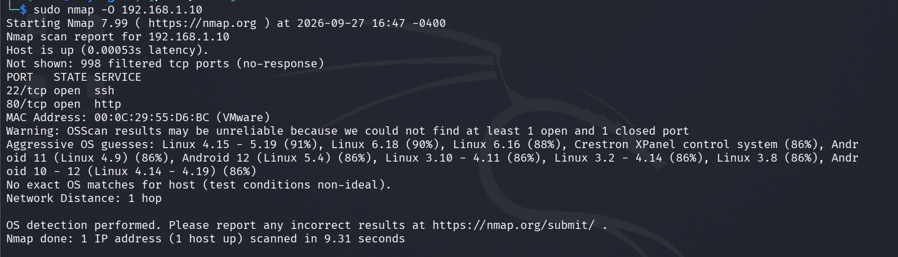

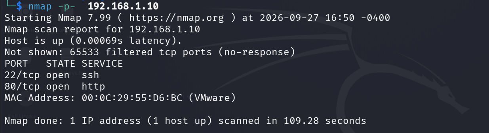

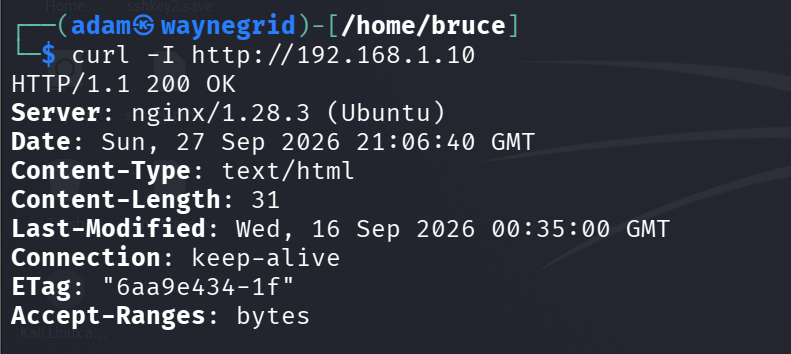

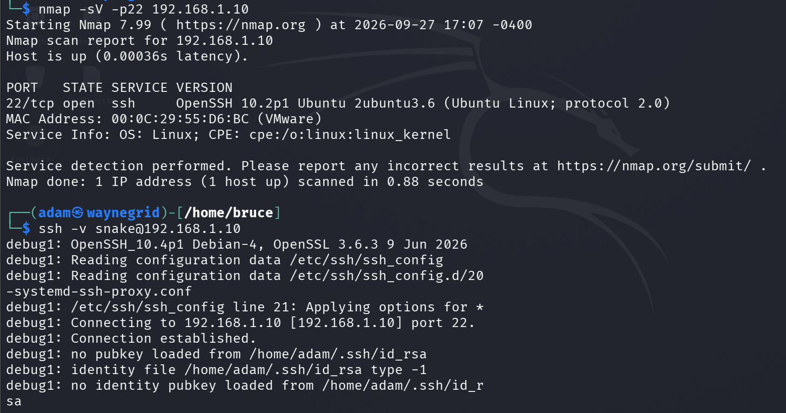

### Local review and firewall

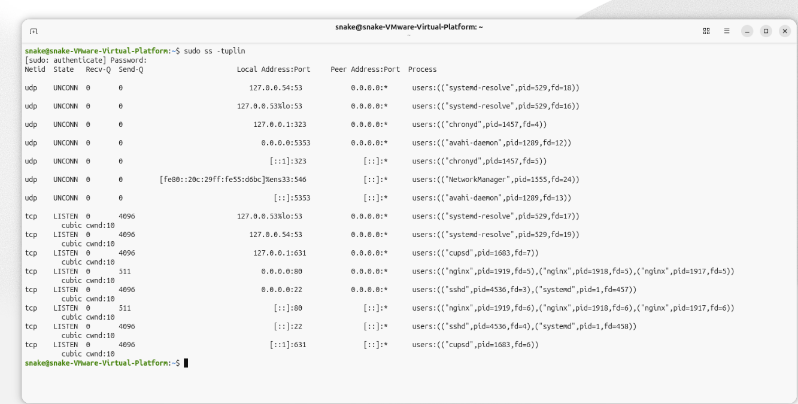

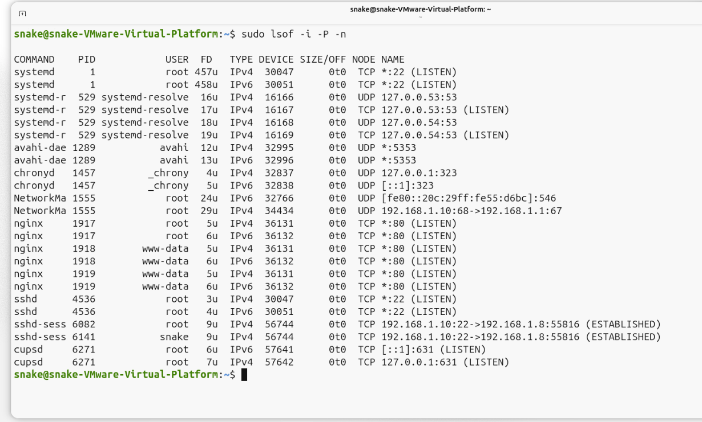

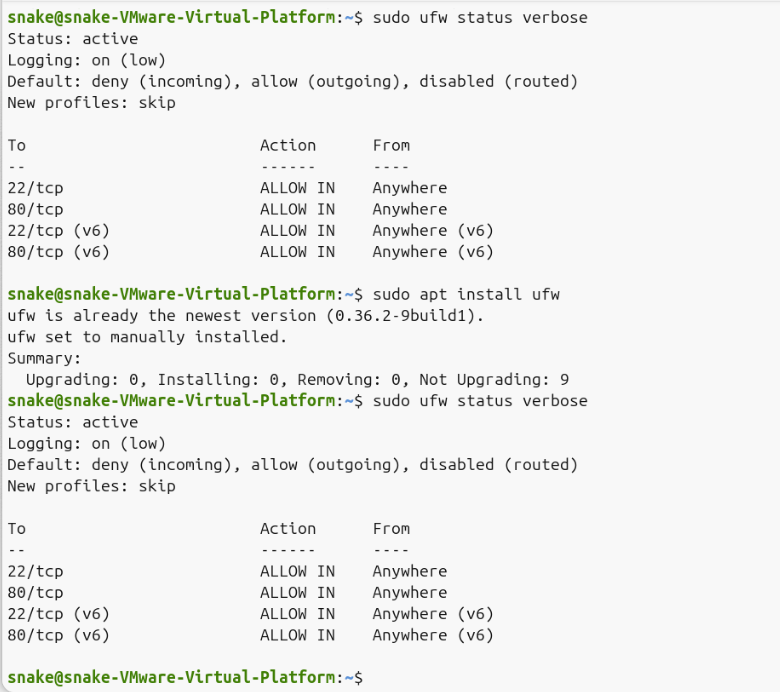

### Remediation and verification

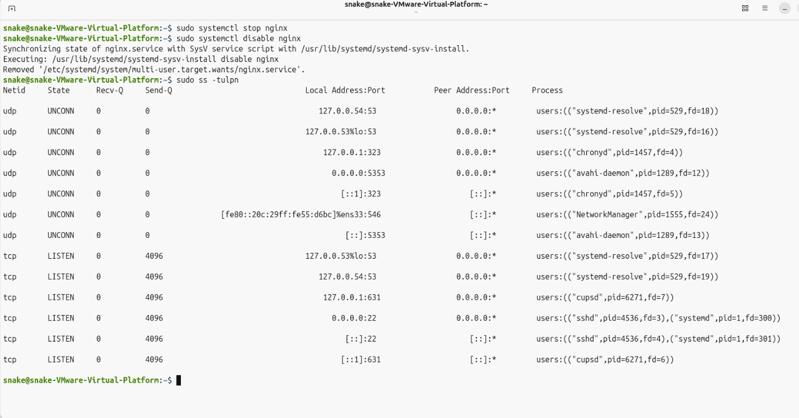

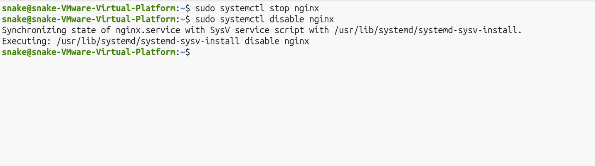

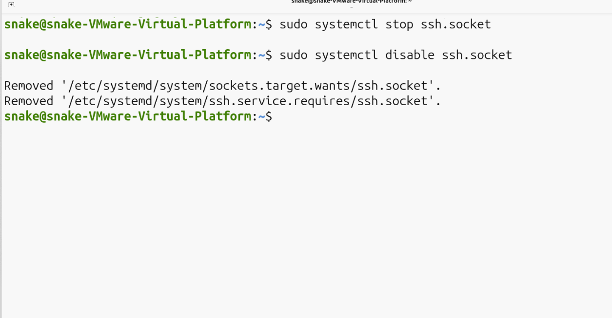

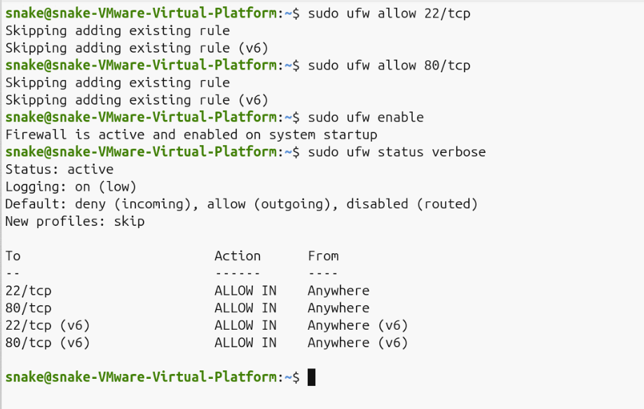

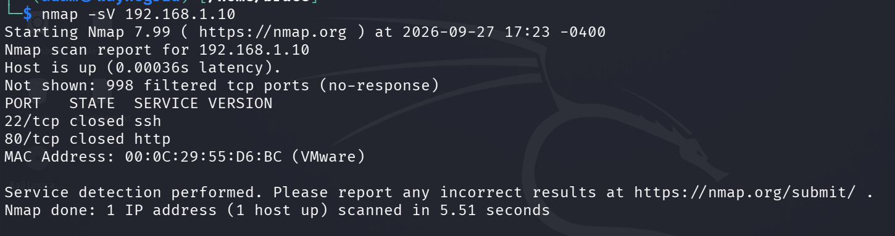

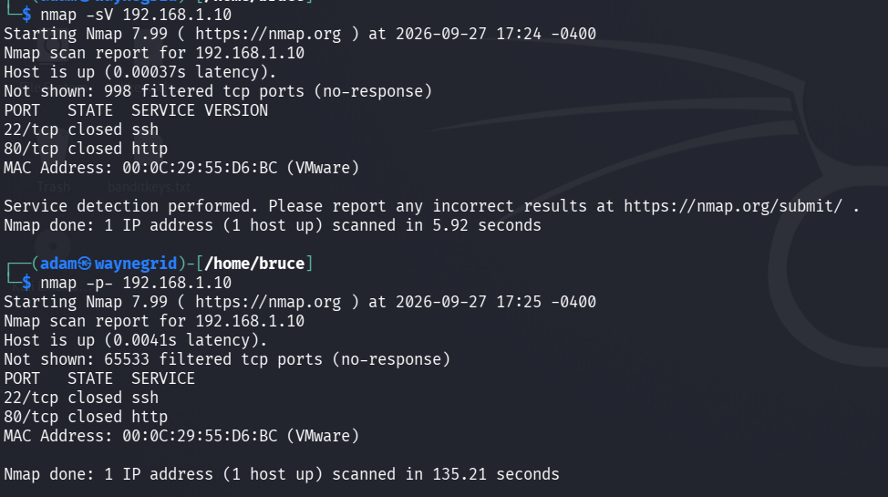

## Full report

The detailed report is available in [`docs/report.md`](docs/report.md). A Word version is also included at [`docs/report.docx`](docs/report.docx).

## Limitations

This was a small virtual lab assessment. It does not represent a full production security assessment. It did not include authenticated vulnerability scanning, exploitation, password attacks, web application testing, or traffic analysis.

The Nmap OS detection result was treated as an indication rather than a confirmed identification because Nmap reported that the fingerprint was unreliable under the observed conditions.
